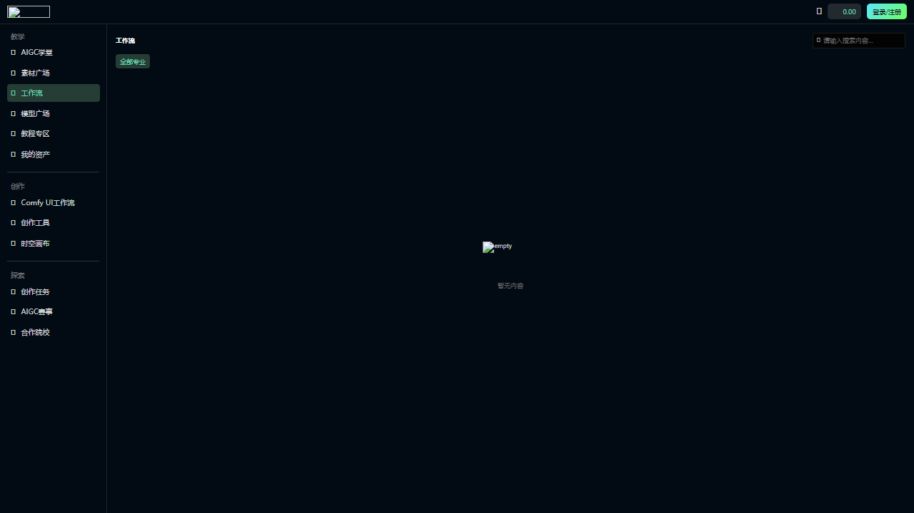
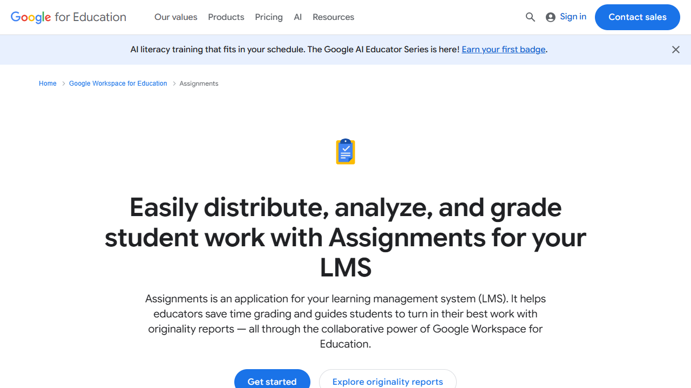
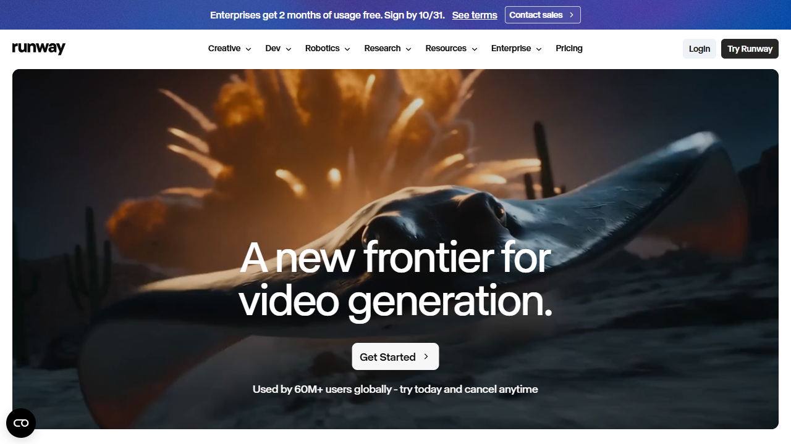
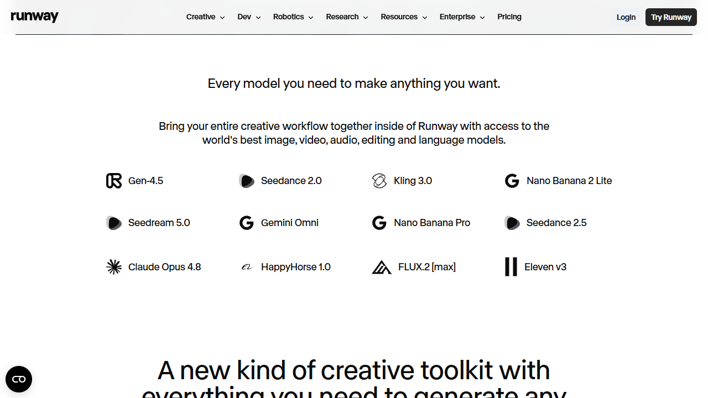
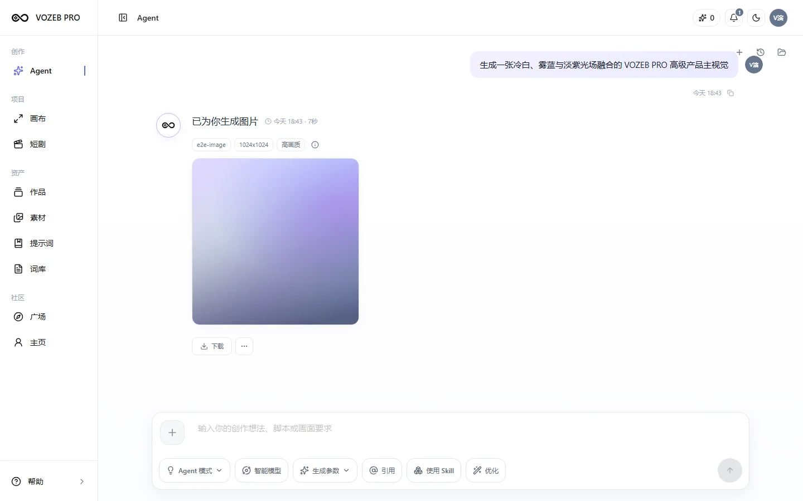
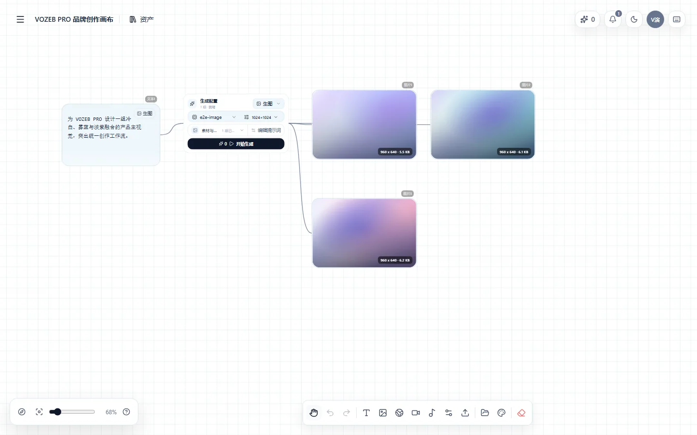
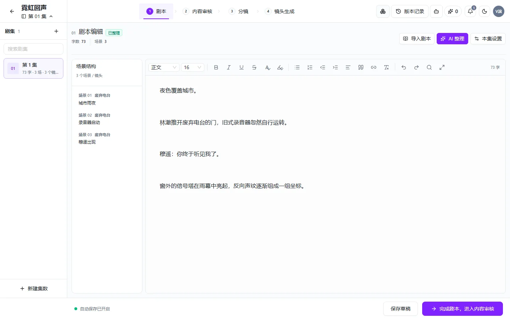

# 10 月 22 日动漫集团推广会：平台功能与 UX 逐页评审稿

> 状态：评审前草案，供产品主持教研、售前、制作、设计和研发逐页过会。
>
> 核心问题：**10 月 22 日让客户看到哪些真实能力、以怎样的页面和操作顺序呈现、每一步实际产出什么。**
>
> 截图说明：竞品图为 2026-10-10 浏览器实拍；VOZEB 图是仓库已有的脱敏基线截图，不能代表 2026-10-10 的运行验收。本地开发环境 PostgreSQL `127.0.0.1:5433` 未连接，登录态教育页、商单页和最新生产画布尚缺实拍。所有“现有”只表示源码存在入口或流程，推广会可演示须另做真实模型与浏览器验收。

## 0. 会议要拍板的五件事

1. **主展示路径**：推荐“课程任务 → 学生无限练习 → 画布/分镜产出 → 教师反馈 → 商单/作品交付”。是否以此为唯一主线？
2. **视觉方向**：推荐“专业教学工作台 + 影视制作台”。教学页清楚、低认知负担；创作页以真实图像、分镜、视频为主角。是否统一采用？
3. **制作功能**：画布真实生图/生视频、多分镜图推故事、白模/白膜推进动画分别在 10 月 22 日展示到什么程度？现场实时、预生成回放、方案效果图，必须明确区分。
4. **部门优先级**：教研确认教学闭环，售前确认产品价值叙事，制作确认镜头生产质量和操作效率；冲突由产品按客户目标与真实可交付性决策。
5. **逐页验收**：每个展示页的功能、视觉、交互、数据、异常状态和负责人签字；任何未签字项不得进入现场话术。

## 1. 截图证据板与设计取舍

### A. EduAI：按教学、创作、探索组织入口



**可借鉴**：把教学、创作、探索分成用户能理解的任务区；工作流按专业和题材进入。**不照搬**：它本次访问的图标、图片及列表接口有加载异常，截图只证明导航与页面结构，不证明工作流质量或真实产出。VOZEB 首页不能堆满模型广场、赛事、素材广场等同级入口，让演示迷路。

### B. Google Assignments：一句话说明教师收益



**可借鉴**：对教研和院校先讲“分发、分析、批改学生作品”，并把反馈/再提交作为任务闭环。**不照搬**：官网是营销页，不能当课堂工作台 UI 样板；量规、原创性检测、LMS 集成不因此自动成为本期功能。

### C. Runway：用真实产出先建立创作信心





**可借鉴**：先给客户看到视频和可交付结果，再讲模型、工作流和企业能力。**不照搬**：营销首页的大幅视频不能放到教师后台或高频制作工作台；用户进入生产区后应以分镜序列、素材、任务状态为主。

### D. VOZEB 当前截图基线

| 页面 | 基线图 | 评审时要特别核对 |
| --- | --- | --- |
| 统一 Agent |  | 作品结果占可视面积、模型参数暴露程度、下一步动作 |
| 画布 |  | 画布有真实节点与连线，但基线图片是示例素材，不能证明真实上游质量 |
| 短剧 |  | 集数/场景/剧本/审核/分镜/镜头之间的操作路径是否可讲清 |

> 需要补图：`/practice`、单项练习、`/learning`、`/teaching`、`/school`、商单交付、最新生产 Canvas、分镜多图与视频结果。补图必须使用脱敏的真实登录态和真实任务状态；不拿示例图充当产出证明。

## 2. 目标风格与 UX 统一准则

### 2.1 推荐风格：专业教学工作台 + 影视制作台

| 层次 | 视觉要求 | 理由 |
| --- | --- | --- |
| 品牌与导航 | 沿用 VOZEB 无限进化 Logo、现有浅/深主题与中文界面；导航只显当前角色要完成的任务 | 让高校和制作方看到同一个平台，避免重做品牌或复制竞品 |
| 教学页 | 浅色优先、清晰表格/列表、紧凑状态标签、课程封面与课时树、可见截止时间与反馈 | 教师高频扫描、批量处理；学生容易找到下一步 |
| 制作页 | 大画布/大媒体、低干扰工具栏、分镜序号和状态固定可见、缩略图轨道与主预览并存 | 制作人员要比较镜头与版本，不能被控制面板挤掉作品 |
| 商业/售前页 | 一条案例主线、成果前后对照、角色与价值摘要、可追溯的任务与交付状态 | 给决策人看交付效率和组织能力，不让其解释模型参数 |
| 动效 | 只服务“从分镜图到镜头运动”“从白模到最终画面”的因果过程；任务执行用明确状态 | 动画不是装饰，必须帮助理解生产步骤 |

**界面语言**：按钮用“生成分镜图”“生成镜头视频”“提交作业”“退回修改”“确认交付”等明确动作。不要用“开始体验”“探索无限可能”替代生产操作。状态至少区分未开始、生成中、待检查、失败、可重试、已完成。页面空态应给下一个真实操作，不展示假样例。

### 2.2 设计决策点

- 导航层级建议为 **学习与教学 / 无限练习 / 创作生产 / 作品与交付 / 管理**。教研可从课时直接进入练习；制作可从项目直接进入画布/分镜；售前用一条案例路径穿过这些区域。
- **先任务后模型**：创建入口先显示创作类型、参考素材和目标；模型与参数放到次级弹层或智能规划。管理员渠道配置只在后台展示。
- **先结果后日志**：图片、视频要用真实比例、清晰预览、状态和操作栏呈现；错误、积分和执行日志在需要时展开。
- **镜头序列是一等对象**：故事、分镜文本、候选分镜图、选择的主图、视频、时长与顺序应有稳定关联。多图不应被当成互不相干的聊天附件。
- **可见的继续路径**：生成结果要能继续入画布、用于下一镜、提交作业或交付商单；如果当前尚无真实跳转，不放假按钮。
- **移动端只保障核验和轻操作**：390/430px 能看任务、预览、反馈、重试、提交；复杂批量排序以桌面制作台为主。

## 3. 部门评审口径

| 部门 | 第一关心点 | 必须提供的现场证据 | 本部门最终要签的结论 |
| --- | --- | --- | --- |
| **教研** | 课程目标、课时内容、练习与作业的映射、教师评价、学生改稿 | 一门动漫课程、一个课时、一个练习任务、一次提交/反馈/再提交 | 能否用于真实课堂；哪些步骤需教师陪跑；课程内容是否可复制 |
| **售前** | 平台完整能力、客户角色、价值、采购包与展示可信度 | 学校开课、学生练习、制作产出、教师管理、商单交付的串联路径 | 10/22 能承诺什么，证据是什么，试点如何落地 |
| **制作** | 画布图片/视频质量、素材一致性、分镜批量效率、白模推进、多图推故事、失败恢复 | 同一案例的角色/场景/多分镜图/镜头视频/成片，及任务和版本记录 | 能否实际投入生产；哪些操作缺口会中断镜头流程 |
| **产品/设计** | 信息架构、角色入口、状态与下一步动作、视觉一致性 | 逐页截图和一条可重复演示的点击路径 | 页面方案、交互细节和 P0/P1 范围 |
| **研发列席** | 现有能力、缺口、上游模型与数据依赖、稳定性 | 源码/API、真实任务、刷新恢复、失败重试和浏览器结果 | 每项是已实现待验收、需修改还是新增；估时与风险 |

## 4. 逐页评审顺序与验收表

**状态口径**：`现有待验收` = 有源码入口但本次未完成真实登录/模型核验；`改版建议` = UX/页面调整，尚未决定；`新增待评估` = 不视为已有能力。优先级是主持人建议，须会上定稿。每一行现场填写“保留 / 修改 / 延后 / 取消 + 负责人 + 截止时间”。

### P01 平台入口与角色导航（售前主审，教研/制作复核）

**页面目的**：客户 30 秒内分清“教学、练习、生产、交付”。主屏不做宣传落地页，登录后直接进入该角色的工作区。

**目标效果**：教师看到本周课程/待批改；学生看到下一课时/未交任务；制作人员看到正在制作的项目/待检查任务；售前演示账号可快速切换到预置案例。导航组名、图标、当前状态清楚，深浅主题一致。

| 功能点 | 状态 | 建议优先级 | 逐项验收动作 |
| --- | --- | --- | --- |
| 学生/教师/学校管理员角色入口和权限 | 现有待验收 | P0 | 各账号登录，检查只看见可用入口；跨校资源不可见 |
| “课程 → 练习 → 作品”路径入口 | 改版建议 | P0 | 从教师课程和学生任务出发，两次点击内找到练习 |
| “项目 → 画布/短剧/商单”入口 | 现有待验收 + 改版建议 | P0 | 打开同一演示项目，返回后上下文不丢 |
| 模型广场、插件、运营入口的展示范围 | 评审取舍 | P1 | 10/22 导航不让客户误入未准备模块 |

**评审问题**：首屏按角色分别长什么样？售前现场展示一个账号还是角色切换？

### P02 课程与课时（教研主审，售前复核）

**页面目的**：让院校看见课程有结构、资料和教学任务，且能落到具体专业能力。

**目标风格/UX**：左侧课程/章节/课时树，中间课时目标与资料，右侧或底部仅显示本课的练习/作业/反馈；避免“课程介绍”大段文字淹没任务。课程封面、课时目标、前置知识、参考案例、交付标准要可扫描。

| 功能点 | 状态 | 建议优先级 | 逐项验收动作 |
| --- | --- | --- | --- |
| 平台课程发布、分配学校、班级与教师安排 | 现有待验收 | P0 | 平台课程在教师和学生账号中按授权出现 |
| 章节、课时、平台/学校资料 | 现有待验收 | P0 | 打开指定课时，资料能预览/下载，来源清楚 |
| 课时与“动漫角色/场景/分镜练习”关联 | 改版建议 | P0 | 课时有明确“去练习”入口，练习回来仍在该课时 |
| 学习目标、岗位能力、作品验收标准 | 内容需教研提供 | P0 | 教研带一套样例逐字段确认可展示内容 |
| 课程模板复制、教学数据汇总 | 新增待评估 | P1 | 明确老师是否真实需要，确定最小模板字段 |

**教研必须回答**：10/22 要讲哪一门课、哪一课时、学生练哪项能力、教师用什么标准判断“可交付”。

### P03 教师教学中心（教研主审）

**现状源码**：`/teaching` 有“我的班级 / 我的课程 / 作业 / 学生提交 / 商单任务”标签、作业发布/关闭、学生提交和反馈。**当前缺实拍**。

**目标效果**：教师进来首先看到待处理数和最近截止任务，打开一份学生作品时能同时看到任务要求、参考素材、学生成果、版本/状态、反馈输入；“通过”和“退回修改”相邻但语义明确。

| 功能点 | 状态 | 建议优先级 | 逐项验收动作 |
| --- | --- | --- | --- |
| 班级与课程安排 | 现有待验收 | P0 | 教师仅看到自己负责范围 |
| 创建课时任务、作业、课程实训并发布 | 现有待验收 | P0 | 新建、发布、学生可见、关闭的状态一致 |
| 查看图片/视频/画布/短剧成果引用 | 现有待验收 | P0 | 缩略图可预览；失效引用有明确说明 |
| 教师反馈、退回、学生改稿、再次提交 | 现有待验收 | P0 | 完成一次真实往返，刷新后状态不变 |
| 结构化评价量规、批量批改 | 新增待评估 | P1 | 教研先定评价维度，再设计表单与汇总 |

**教研签字**：教学闭环是否能讲成“老师少做了什么、学生多学会了什么”。

### P04 学生学习中心（教研主审，制作复核）

**现状源码**：`/learning` 有“我的课程 / 课时 / 作业 / 已交作业 / 实训 / 商单实训 / 反馈”；可引用既有作品、画布、短剧和素材提交。**当前缺实拍**。

**目标效果**：学生看见“下一步做什么”，不是先面对全部工具。任务详情固定展示截止时间、验收标准、可用参考素材、创作入口和已有提交；退回后直接回到相关作品继续改。

| 功能点 | 状态 | 建议优先级 | 逐项验收动作 |
| --- | --- | --- | --- |
| 课程树、课时和资料 | 现有待验收 | P0 | 学生能从指定课时找到任务 |
| 从任务进入对应无限练习或短剧/画布 | 改版建议 | P0 | 创建结果带回稳定来源，不只跳到空白工具 |
| 选择真实成果提交并查看教师反馈 | 现有待验收 | P0 | 提交、刷新、退回、重交均有正确结果 |
| 练习历史、作品进步对比 | 部分现有 + 新增待评估 | P1 | 确定教研要看过程还是最终版，避免重复记录 |

### P05 无限练习首页与单项练习（教研/制作共同主审）

**现状源码**：`/practice` 有无限画布、无限短剧、剧本、角色、场景、道具、分镜图、分镜视频、音频模块和最近记录。模块目前是独立练习，首页文案明确它们不是完整流水线。

**目标效果**：按“先剧本/设定 → 再分镜 → 再镜头/声音”的学习顺序呈现，但独立练习仍能单独进入。每张入口展示示例输入、能得到的结果、预计操作步骤、继续去向；不要暗示模块之间已有自动串联。

| 功能点 | 状态 | 建议优先级 | 逐项验收动作 |
| --- | --- | --- | --- |
| 六类模块与剧本练习实际可用 | 现有待验收 | P0 | 各模块打开、输入、生成、保存和重进；至少完整演示角色/分镜/视频链 |
| 当前课程/作业上下文入口 | 改版建议 | P0 | 从课时进入时显示任务要求与交付标准 |
| 参考素材、IP/资产复用 | 现有待验收 | P0 | 同一角色参考用于后续场景/分镜，不丢身份 |
| 练习结果继续进画布、作业或商单 | 部分现有 + 改版建议 | P0 | 现场点通一条真实链；其余入口若未通不显示 |
| “无限”的额度和服务边界说明 | 业务待确认 | P0 | 教研、售前、财务统一口径，不承诺无限算力 |

### P06 画布：图片与视频真实生产（制作主审，售前复核）


**页面目的**：制作人员能从真实参考素材生成图、挑选结果、继续图生视频，并看见素材关系；售前能向客户证明“这是一条可操作、可恢复的生产链”。

**目标 UX**：画布主区域保留最大空间；常用动作贴近选中节点，属性与生成参数在同层侧面板；工具栏只放创建、连接、整理、预览、下载等明确工具。图片/视频节点真实比例展示，连线表达依赖。任务状态贴在相应节点，不用全局弹窗掩盖结果。

| 功能点 | 状态 | 建议优先级 | 逐项验收动作 |
| --- | --- | --- | --- |
| 文本/参考图 → 图片任务 → 多结果节点 | 现有待验收 | P0 | 同一输入生成真实图片；所有成功结果保留，尺寸与引用正确 |
| 图片节点 → 视频任务 → 可播放视频 | 现有待验收 | P0 | 指定图片做首帧/参考；真实上游返回后可播放、下载、刷新恢复 |
| 节点移动、连接、框选、缩放、撤销/重做、整理 | 现有待验收 | P0 | 现场做一组操作，任务运行中和刷新后无错位/丢失 |
| 多图选择、主结果、下一镜继续引用 | 部分现有 + UX 待评估 | P0 | 选中哪张、为什么选、如何进入下一镜都可见 |
| 失败节点待检查、直接重试、成功保留 | 现有待验收 | P0 | 一条失败任务不清掉成功结果，重试不重复创建旧任务 |
| 结果打包下载与项目导出 | 现有待验收 | P1 | 完整性、文件命名和缺失项报告正确 |

**制作验收标准**：至少完成同一案例的 1 张角色图、1 张场景图、3 张有顺序的分镜图、1 段镜头视频；确认参考素材、角色外观、镜头信息和结果归属。不能只出一张孤立图片后宣称画布生产可用。

### P07 核心制作评审：多分镜图推故事（制作主审，教研复核）

**用户需求原话**：“多分镜图，多分镜图推故事”。当前短剧/实验室存在剧本拆分镜、单镜/批量生图与视频能力；尚未在本次环境证实“选多张分镜图 → 推进故事”的独立产品链路。此项按**新增/改版待评估**，需要制作部门明确“推故事”要产出文本故事、连续分镜、镜头视频，还是三者之一。

**建议页面形态**：上方显示故事目标和集/场次；中间是一条有序分镜轨道，每镜含序号、画面缩略图、镜头说明、角色/场景/道具、时长与状态；右侧主预览显示选中镜的大图/视频；底部为“补镜、重排、替换主图、生成后续故事、生成镜头视频”操作。多张图必须可一眼比较，不能藏在单张预览的轮播器里。

```text
项目 / 第 01 集 / 场次 03      故事目标：追逐与反转       [保存] [版本]
┌──────────────────────── 分镜轨道 ────────────────────────┬──────────────── 主预览 ────────────────┐
│ 01 [缩略图] 建立空间  3s  已确认                        │ [选中镜头的大图 / 视频，保持真实比例]    │
│ 02 [缩略图] 人物入场  4s  已出图                        │ 起点 / 终点 / 参考图 / 候选版本          │
│ 03 [缩略图] 冲突动作  5s  视频生成中                    │ 镜头文本、人物、场景、道具、时长          │
│ 04 [缩略图] 转场推进  3s  待生成                        │ [选主图] [生成视频] [重试] [下载]         │
│ [+ 补镜] [拖动排序] [批量生成缺失镜头]                 │ 只显示当前镜头可执行的动作               │
└──────────────────────────────────────────────────────────┴────────────────────────────────────────┘
底部：故事版本 / 教师或制作反馈 / 任务历史；不遮挡分镜轨道。
```

**评审时看三个状态**：空白新项目有明确首个动作；一组镜头生成中时每镜状态不同且结果陆续出现；单镜失败时其他镜头继续可预览、重排和交付。此线框是讨论用布局草案，不是已实现 UI 截图。

**建议最小行为契约**：

1. 用户选择 **2 张及以上**有顺序的真实分镜图，指定故事目标、已有剧本范围和结尾约束。
2. 系统保留每张图的来源、顺序和角色/场景引用；给出镜间叙事建议或后续分镜草案供人确认。不得直接覆盖原剧本或已确认分镜。
3. 用户可逐镜编辑对白、动作、景别、机位和时长，调整顺序后重新推演；变化只影响指定镜头及其下游。
4. 已确认分镜可批量生成候选图和视频；每镜分别显示结果、失败与重试，允许只重做一个镜头。
5. 输出能回到同一项目/集/场次，刷新后镜序、主图、故事版本和视频任务仍在。

| 评审项 | 制作部门要定的答案 | 10/22 建议 |
| --- | --- | --- |
| 输入 | 几张图、是否要相同角色/IP、是否允许不同画幅 | 用一套 3–5 镜样例固定输入 |
| “推故事”的输出 | 故事梗概、镜头文本、后续分镜图、连续视频中的哪项是必须 | 先选一个可真实验证的核心输出 |
| 控制力 | 哪些镜必须锁定、哪些可自动补、可否指定首尾镜 | 明示人可选图、排序、改镜头说明 |
| 连续性 | 角色、场景、服装、光照、视线/动作衔接 | 由制作人员给出可观察验收图 |
| 失败恢复 | 部分镜头失败时是否保留成功项 | 必须保留，逐镜重试 |
| 演示级别 | 现场实时生成 / 已验证回放 / 设计方案 | 只有真实跑通并彩排过才进入实时演示 |

**建议优先级**：10/22 **P0 评审与演示方案**；若现有短剧批量分镜图链路实测可用，则 P0 展示真实“多镜结果 + 单镜继续制作”。“多图自动推故事”的新增编排若未完成真实验收，只展示交互设计和预期效果，标为后续实现，不说已上线。

### P08 核心制作评审：白模/白膜推进动画（制作主审）

**术语待确认**：这里可能是“白模场景的镜头推进/运镜预演”，也可能是“白模逐步演变为成片画面的动画”。两者的素材、算法、UI 和验收完全不同；制作部门应在会议开始前选定含义，文档目前不把它写成现有功能。

| 方案 | 目标画面 | 最小输入/操作 | 验收证据 |
| --- | --- | --- | --- |
| A：白模镜头推进 | 白模场景中摄影机从起点向目标推进，可看景别变化和动线 | 白模/场景、起止机位或路径、时长、预览/导出 | 连续镜头视频；开始/结束构图与指定机位一致 |
| B：白模到最终画面演变 | 同一镜头从白模、材质/光照、最终风格逐步转化 | 白模图/视频、目标风格/参考、阶段控制、预览/导出 | 阶段间主体与构图保持一致；可回看节点与版本 |

**建议 UX**：在分镜镜头详情或画布节点中提供“镜头预演/白模推进”专用模式，不把它混成通用“视频生成”参数。主预览同时有起点、终点、时间轴/阶段条；播放、暂停、关键帧、重新生成、下载可直接找到。未知上游能力、失败、待检查有显式状态。

**10/22 决策门槛**：制作确认样例与预期画面，研发确认输入格式、模型/渲染方案、时长和真实输出，产品确认展示口径。若任何一项缺证据，列为 **P0 方案评审 / P1 功能交付**，现场只讲设计方向并标注概念效果，不播放“伪装平台实时生成”的素材。

### P09 短剧/一键成片（制作与售前共同主审）


**现状边界**：正式短剧有剧本、内容审核、分镜、镜头生成四阶段与项目资产；创作工坊是教学版，一键成片定位为商单生产版，两者不能混称。现有文档记录分镜图片/视频、音频与成片链路，但真实渠道、真实媒体和持久化环境仍需按推广案例验收。

**目标效果**：顶部只有一条阶段线；左侧项目/集数，中央当前阶段主任务，右侧项目 Agent/设置按需展开。镜头阶段每镜能看到文本、参考、候选图、视频、任务状态；整体进度与阻塞原因可扫读。成片前能定位失败镜头，不要求重跑整集。

| 功能点 | 状态 | 建议优先级 | 逐项验收动作 |
| --- | --- | --- | --- |
| 剧本创建/编辑、集数、审核门禁 | 现有待验收 | P0 | 一集完整走到已审核分镜 |
| 项目级角色、场景、道具及主参考图 | 现有待验收 | P0 | 同一角色跨三镜外观连贯，资产来源可查 |
| 单镜/批量分镜图、主图选择、失败重试 | 现有待验收 | P0 | 3–5 镜真实批量结果、部分失败保留 |
| 分镜图生成镜头视频、首尾帧/连续性 | 现有待验收 | P0 | 至少两相邻镜的可播放视频和连贯性检查 |
| 配音、字幕、整集合成/导出 | 现有待验收 | P1 | 若现场展示成片，必须用完整案例真实合成并校验下载 |
| 教学版与商单生产版入口和口径 | 现有 + 改版建议 | P0 | 售前说得清适用人群、权限、计费和成果归属 |

### P10 商单实训、作品与交付（售前主审，制作/教研复核）

**页面目的**：证明课程练习最终可转为项目交付，让动漫集团看见组织能力与商业价值。

**目标 UX**：商单详情顶部固定“任务目标、截止、验收标准、负责人、状态”；中间按“候选成果 → 正式交付 → 反馈/修改 → 已验收”呈现。作品卡只放真实图/视频、所属项目、作者/团队、版本与许可；不把后台财务流水当成果展示。

| 功能点 | 状态 | 建议优先级 | 逐项验收动作 |
| --- | --- | --- | --- |
| 管理员创建商单、指定学校/教师/团队 | 现有待验收 | P0 | 任务只出现在授权学校与成员账号 |
| 学生候选成果、教师正式交付 | 现有待验收 | P0 | 成果与原项目/素材稳定关联，可预览 |
| 平台反馈、退回修改、重新交付、验收 | 现有待验收 | P0 | 每次状态和意见刷新后仍可追溯 |
| 作品展示、分享、审核和下架 | 现有待验收 | P1 | 只展示已授权作品，视频可播放 |
| 售前价值摘要：课时、练习、作品、交付 | 新增待评估 | P1 | 先确定可核实的数据字段，不写虚假收益指标 |

## 5. 10 月 22 日推荐演示顺序（由制作结果带动叙事）

| 分钟 | 页面/动作 | 主讲价值 | 依赖证据 |
| --- | --- | --- | --- |
| 0–1 | 放最终动漫片段或连续分镜结果 | 先让客户看到能产出什么 | 已授权且可播放的实际作品 |
| 1–3 | 课程/课时与教师任务 | 教研有课程目标和评价标准 | 学校、教师、学生账号与课程数据 |
| 3–5 | 学生无限练习：角色/场景/分镜 | 降低学生创作起步门槛 | 同一 IP/角色参考与练习结果 |
| 5–9 | 画布与多分镜：选图、排序、继续到视频 | 核心制作效率和可控性 | 真图、真实视频、镜头顺序、任务状态 |
| 9–11 | 白模推进或故事推演 | 差异化制作方向 | 仅展示已验收功能；否则作为明确标注的设计方案 |
| 11–13 | 教师反馈与商单正式交付 | 从学习到商业交付 | 提交、退回、重交、验收记录 |
| 13–15 | 售前总结：师陪 + 平台 + 课程 + 内容生产 | 合作方式和试点范围 | 经确认的采购/服务口径 |

**演示原则**：凡宣传为“平台已支持”的能力，必须在同一登录环境由真实输入得到可见结果，并证明刷新后任务、媒体和归属不丢。预生成素材可以用于节省等待，但必须说明它是预先在平台生成的结果；概念动画需标“设计效果”。

## 6. 评审会议的实际操作方法

每页由主持人投屏“当前截图 → 目标布局/效果 → 点一遍核心操作”。部门不按抽象需求发言，按该页提问。每页控制 8–12 分钟，制作三页（P06–P09）合计保留至少 40 分钟。

| 轮次 | 主持动作 | 记录员填写 |
| --- | --- | --- |
| 1. 看 | 投屏当前图和目标效果，指出页面唯一任务 | 页面/截图版本/参会角色 |
| 2. 点 | 从入口点到结果，覆盖空态、生成中、失败、完成 | 每个按钮的实际结果与断点 |
| 3. 问 | 教研问教学目标，售前问客户价值，制作问产出与控制 | 部门意见及证据链接 |
| 4. 定 | 确定保留/修改/延后/取消、P0/P1、展示方式 | 单一负责人、截止、验收人 |

### 每个功能点统一的签字栏

| 字段 | 评审时填写 |
| --- | --- |
| 页面与功能 ID | 例：P07-03 多分镜排序 |
| 当前截图/真实操作证据 | 文件、URL、任务 ID（脱敏）、日期 |
| 目标画面与用户操作 | 输入、点击、状态、输出、下一步 |
| 部门意见 | 教研 / 售前 / 制作分别写“可用、缺口、理由” |
| 决议 | 保留 / 修改 / 延后 / 取消；P0/P1/P2 |
| 演示级别 | 实时可操作 / 预生成平台结果 / 设计效果 / 不展示 |
| 验收人和截止 | 业务负责人、设计、研发、最终彩排时间 |

## 7. 会前与会后交付

**会前必须备齐**：教研交课程样例与评价标准；制作交同一故事的角色、场景、3–5 张有顺序的分镜、目标视频和“白模”定义；售前交客户决策人、采购问题和价值口径；产品交逐页最新截图、可点击演示环境、功能状态清单；研发交真实模型配置、失败/恢复记录和功能可行性判断。

**会后当天**：形成逐页结论表、P0 展示范围、UX 改版清单、制作新功能方案、演示脚本与风险台账。未达成一致的点保留两种方案、验证负责人和截止时间，不写成已通过。

**上线前验收顺序**：先实拍教育与商单页补齐本稿空缺；再以同一故事跑通图片、视频、多分镜结果和交付；随后做桌面与 390/430px 浏览器核验、浅深主题、刷新恢复与部分失败；最后录制彩排并冻结话术。10 月 22 日前如白模或多图推故事无法完成真实验收，现场只展示明确标注的方案与已完成的相关生产能力。

## 8. 证据来源与限制

- 竞品实拍：[EduAI 工作流](https://www.eduai.art/workflow)、[Google Assignments](https://edu.google.com/intl/ALL_us/workspace-for-education/products/assignments/)、[Runway Creative](https://runway.com/product)。截图仅用于内部功能与 UX 对比，不作为品牌素材复用。
- VOZEB 基线截图：`docs/public/screenshots/pages/02-create.webp`、`03a-canvas-editor.webp`、`04a-drama-editor.webp`。
- 当前源码：`web/src/app/(user)/practice/`、`learning/page.tsx`、`teaching/page.tsx`、`canvas/[id]/`、`drama-lab/[id]/`、`web/src/lib/school-domain.ts`。
- 既有范围文档：`docs/superpowers/specs/2026-09-15-one-click-video-production-requirements.zh-CN.md`、`docs/content/docs/progress/drama-lab-storyboard-workbench-alignment.mdx`、`docs/content/docs/progress/pending-test.mdx`。
- 本次未运行真实模型、登录态 PostgreSQL 或生产环境验收；不能由源码或脱敏截图推断性能、媒体质量与商业可用性。
